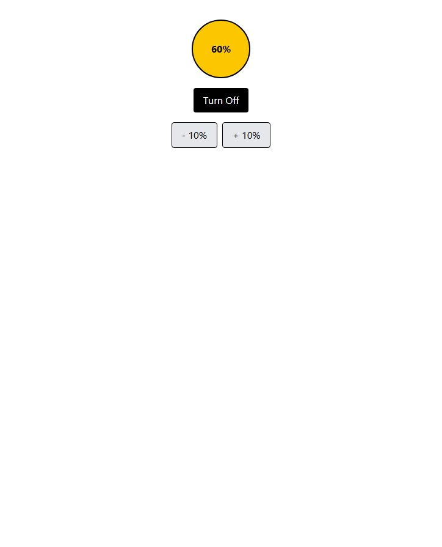

# Bulb Project

A simple bulb app built with React and useState.

## How useState is used

- brightness stores the brightness percentage. The **+10%** and **-10%** buttons update it.
- isOn stores whether the bulb is on. The power button toggles it.